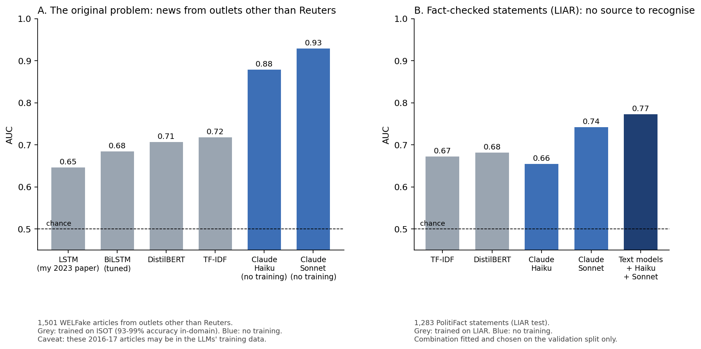

# Fake News Detection: LSTM to LLM

I re-examined my own published fake-news detector, which reported **99% accuracy**, and found that the score came from recognising the **news source**, not from detecting falsehood. I then rebuilt the evaluation step by step: from the original LSTM to BiLSTM, DistilBERT and Claude LLMs, on test sets where the source cannot give the answer away.



## Highlights

- **Found the flaw in my own published result.** In the Kaggle ISOT dataset every real article comes from Reuters, so a model can score highly just by recognising Reuters' writing style: the headline alone gives 94%. On news from other outlets, the same models fall to 52–59% accuracy (always answering "real" scores 56%) and call about half of New York Times articles fake.
- **Showed that changing the data matters more than changing the model.** LSTM → BiLSTM → DistilBERT barely changed cross-source performance, and removing style words made it worse. Training on several outlets raised AUC on an unseen outlet from **0.79 to 0.97**.
- **Measured the real difficulty, then improved on it with LLMs.** On fact-checked PolitiFact statements (LIAR), where there is no source to recognise, text-only models reach AUC 0.68. Combining them with Claude Sonnet 5.5 reaches **0.77 (about 70% accuracy)**, reliably above every single model.
- **Returned to the original problem.** On the same out-of-source articles where my original LSTM scores AUC 0.65, zero-shot Claude Sonnet reaches **0.93** and accepts 99.8% of New York Times articles instead of about half, with the caveat that these 2016–17 articles may be in its training data.
- **Kept the results honest.** Leakage audit, grouped splits, every choice made on validation data under rules fixed in advance, paired bootstrap tests, a control for every LLM experiment, and memorisation checks. Two promising-looking ideas (Wikipedia evidence and speaker context) are reported as negative results.

## The story

**1. A result that was too good** (`00`, `01`, `04`). I reproduced my 2023 LSTM (99.1% accuracy) and audited the data. Real news in ISOT carries Reuters bylines and Reuters house style, and the `subject` column alone almost separates the classes. After symmetric cleaning and near-duplicate removal, a bag-of-words model still reaches 94% from the title alone: the labels are effectively the source.

**2. Nothing transfers** (`02`, `03`, `05`). I trained LSTM, BiLSTM, DistilBERT and a TF-IDF baseline on a cleaned, grouped split (3 seeds each) and tested them on WELFake articles from other outlets, with every article that overlaps ISOT removed. All of them score 93–99% inside ISOT and 52–59% outside it. An ablation of my original LSTM showed that most earlier "optimisations" were within seed noise.

**3. What actually reduces source reliance** (`06`). Removing style words and down-weighting easy-to-recognise articles both made transfer worse, because the source shows in topic as well as style. Training on several outlets, with the New York Times held out, raised AUC on that unseen outlet from 0.79 to 0.97.

**4. A benchmark without the shortcut** (`07`). LIAR contains 12,836 political statements, each rated by PolitiFact editors, so the same speaker says both true and false things and there is no source to recognise. Text-only models reach only AUC 0.67–0.68.

**5. LLMs on LIAR: what helped and what did not** (`08`–`10`).

| Idea | Result |
|---|---|
| Claude Haiku 4.5, statement only | AUC 0.655, no better than text-only models |
| Haiku + retrieved Wikipedia evidence | No gain. A random-evidence control showed the evidence content helps (+0.034), but adding passages made the model over-sceptical (−0.042) |
| Haiku combined with DistilBERT and TF-IDF | **0.73**: the LLM's scores are almost uncorrelated with the text models' (Spearman 0.12–0.17) |
| Claude Sonnet 5.5, a larger model | **0.74 alone, 0.77 combined**. A speaker-recall check suggests the gain comes mainly from knowledge, not memory |
| Telling the model who said it | A shortcut, not context: the speaker's track record alone reaches AUC 0.65, and the gain sat on famous speakers |

Error analysis (`09`) found that the main remaining bottleneck is missing context: on statements such as "*he* cut *this bill*", the combined model drops from AUC 0.75 to 0.65.

**6. Back to the original problem** (`11`). Zero-shot LLMs were never trained on data whose labels equal the source, so they cannot have learned the Reuters shortcut. On 1,501 WELFake articles, Sonnet reaches AUC 0.93 against 0.65–0.72 for every ISOT-trained model.

## How the results were kept honest

- **Leakage audit before modelling.** Symmetric cleaning of bylines, URLs and boilerplate; exact and near-duplicate removal (union-find over titles, leads and tails); a grouped 64/16/20 split locked in `data/processed/splits.csv`; shortcut probes on headlines, first and last words, and character shape.
- **Clean external test sets.** Five fingerprints remove every WELFake article that overlaps ISOT. WELFake's labels turned out to be inverted relative to its documentation, which I verified against 44,058 matched ISOT articles.
- **Decisions on validation data only.** Hyperparameters, combination weights and thresholds were all chosen on validation splits. Each LLM extension had to improve 5-fold cross-validated AUC on the validation set by at least 0.01 before it was run on the test set; two of the three did not, and were never tested.
- **Controls for every LLM experiment.** Evidence from another statement (5b), another statement's speaker (5f), and a speaker-reputation baseline built from training labels only.
- **Memorisation checks.** A speaker-recall probe on LIAR; on WELFake, a verbatim-continuation test was attempted, but the model declines to reproduce published text, so this is stated as a limitation rather than claimed.
- **Statistics.** 3 seeds per neural model, bootstrap 95% confidence intervals, and paired bootstrap tests for every model comparison.
- **Engineering.** 102 unit tests; a resumable experiment runner; LLM calls through the Batch API with structured outputs and retries of failed requests (a failed request is never scored as "don't know"). Total LLM cost was about $6.

## Results

**In-domain vs cross-source** (ISOT test; WELFake test minus ISOT, majority baseline 56.1%; mean ± std over 3 seeds)

| Model | ISOT accuracy | WELFake accuracy | WELFake AUC |
|-------|--------------:|-----------------:|------------:|
| LSTM, my paper (original run, leaky data) | 99.1% | — | — |
| LSTM, paper settings, clean data (A0) | 93.5 ± 1.0% | 54.9 ± 5.0% | 0.628 |
| BiLSTM, tuned (A6) | 97.6 ± 0.4% | 56.4 ± 0.2% | 0.673 |
| DistilBERT | 99.0 ± 0.3% | 58.6 ± 0.7% | 0.693 |
| TF-IDF + logistic regression | 98.7% | 56.7% | 0.714 |

**Zero-shot LLMs on the same cross-source problem** (1,501 stratified WELFake test articles, title + first 300 words; ISOT models scored on the same articles)

| Model | Accuracy | AUC | NYT accepted as real | Fakes accepted as real |
|-------|---------:|----:|---------------------:|-----------------------:|
| LSTM, my paper settings (A0) | 55.6% | 0.646 | 39.2% | 17.8% |
| DistilBERT (trained on ISOT) | 59.6% | 0.707 | 50.2% | 11.7% |
| TF-IDF (trained on ISOT) | 57.5% | 0.718 | 43.2% | 8.3% |
| Claude Haiku 4.5, zero-shot | 77.5% | 0.878 | 99.2% | 43.4% |
| **Claude Sonnet 5.5, zero-shot** | **78.3%** | **0.929** | **99.8%** | 46.4% |

The LLMs rank articles well but accept too many fakes at the default threshold, which was not tuned on WELFake.

**Multi-source training** (test: unseen New York Times articles + fake articles)

| Training data | Model | NYT accepted as real | Fakes accepted as real | AUC |
|---------------|-------|---------------------:|-----------------------:|----:|
| ISOT only | TF-IDF | 43.2% | 9.2% | 0.790 |
| ISOT only | DistilBERT (3 seeds) | 43–47% | 10–14% | 0.76–0.78 |
| ISOT + WELFake, NYT held out | TF-IDF | 84.5% | 5.1% | 0.968 |
| ISOT + WELFake, NYT held out | DistilBERT (3 seeds) | 74–82% | 2–3% | **0.975** |

**LIAR fact-checked statements** (test set, 1,283 statements, majority baseline 56.7%)

| Model | Accuracy | AUC |
|-------|---------:|----:|
| TF-IDF | 62.5% | 0.672 |
| DistilBERT (3 seeds) | 64.3 ± 0.8% | 0.682 ± 0.006 |
| Claude Haiku 4.5, zero-shot | 61.1% | 0.655 |
| Claude Haiku 4.5 + Wikipedia evidence | 53.5% | 0.647 |
| Claude Sonnet 5.5, zero-shot | 67.2% | 0.742 |
| DistilBERT + TF-IDF + Haiku, combined | 66.4–67.5% | 0.725–0.729 |
| **DistilBERT + TF-IDF + Haiku + Sonnet, combined** | **69.9–70.1%** | **0.771–0.774** |
| Speaker's track record only, no text (diagnostic shortcut) | 62.2% | 0.649 |

Combinations are fitted and chosen on the LIAR validation split; ranges cover the three DistilBERT seeds.

## Limitations and next steps

- **Memory vs knowledge.** The LLM results on 2016–17 news cannot fully separate knowing the events from having seen the articles. The decisive test is news published after the models' training cut-off.
- **Labels by site.** WELFake, like ISOT, labels articles by outlet, so even the zero-shot LLMs may partly judge style.
- **Missing context on LIAR.** Statements lack dates and the events they refer to. Adding them would mean scraping PolitiFact pages, which also contain the verdicts, so it was left out to avoid leakage.
- **Scope.** Only Claude models were tested as LLMs; LLM thresholds were not calibrated on WELFake; half-true is counted as true in the binary LIAR task.

## Tech stack

Python · pandas · scikit-learn · TensorFlow / Keras (LSTM, BiLSTM) · PyTorch + Hugging Face Transformers (DistilBERT) · Anthropic API (Claude Haiku 4.5 and Sonnet 5.5, Batch API, structured outputs) · MediaWiki API (evidence retrieval) · pytest

## Repository guide

| Notebook | What it shows |
|----------|---------------|
| `00_eda`, `01_lstm_reimplementation` | Data exploration and a reproduction of my 2023 paper |
| `02_lstm_corrected`, `03_transformer_distilbert` | LSTM / BiLSTM ablation and DistilBERT on the cleaned pipeline, in-domain and cross-source |
| `04_leakage_audit` | Residual artefacts, duplicate overlap, shortcut probes |
| `05_cross_dataset` | Transfer from ISOT to WELFake and LIAR |
| `06_reducing_source_reliance` | Content-only input, de-biased reweighting, multi-source training |
| `07_liar_benchmark` | Text-only models on fact-checked statements |
| `08_llm_prompting` | Claude on LIAR: no evidence, Wikipedia evidence with a control, combination with text models |
| `09_error_analysis` | Where and why the combined model fails |
| `10_larger_model_and_context` | Sonnet 5.5, memorisation check, speaker context, evidence in the combination |
| `11_llm_cross_source` | Zero-shot LLMs on the original cross-source problem |

```
src/
├── data.py              # Shared pipeline: symmetric cleaning, de-duplication, grouped split
├── external.py          # WELFake and LIAR: download with MD5 check, same cleaning, ISOT-overlap removal
├── probes.py            # Leakage-audit tools
├── baselines.py         # TF-IDF + logistic regression, metrics, bootstrap CIs
├── lstm_model.py        # LSTM / BiLSTM ablation ladder
├── distilbert_model.py  # DistilBERT fine-tuning
├── experiments.py       # Resumable runner: one JSON + NPZ per model × config × seed
├── analysis.py          # Publisher breakdown, paired bootstrap tests
├── step4.py             # Reducing source reliance
├── liar.py              # LIAR benchmark
├── llm_factcheck.py     # Claude on LIAR via the Batch API (evidence, speaker context, retries)
├── evidence.py          # Wikipedia retrieval with leak filters
├── ensemble.py          # Model combination with the validation-only decision rule
├── memorisation.py      # Speaker-recall memorisation check
├── error_analysis.py    # Statement types, model agreement, bias by group
├── llm_crosssource.py   # Zero-shot Claude on WELFake
└── figures.py           # The summary figure above
tests/                   # 102 unit tests
results/                 # Saved metrics and per-example predictions for every run
```

## Reproducing

```bash
pip install -r requirements.txt
python -m pytest tests/
jupyter lab
```

- **Data.** Download the [Kaggle Fake and Real News Dataset](https://www.kaggle.com/clmentbisaillon/fake-and-real-news-dataset) and put `Fake.csv` and `True.csv` in `data/raw/` (see [data/README.md](data/README.md)). WELFake and LIAR are downloaded automatically and checked against their MD5 hashes.
- **Splits.** All models load data through the shared pipeline, and the splits are locked in `data/processed/`:
  ```python
  from src.data import load_dataset, get_splits
  train, val, test = get_splits(load_dataset())   # models read the `model_text` column
  ```
- **LLM experiments.** These need an `ANTHROPIC_API_KEY` and cost about $6 in total through the Batch API. Every LLM prediction is already saved in `results/llm/`, so all notebooks run without an API key.
- **Figure.** `python -m src.figures` rebuilds the summary figure from the saved results.

## Background

This project extends my own publication:

> Liu, S. (2023). *Social Media Fake Information Identification Method Based on LSTM*. Highlights in Business, Economics and Management, Vol. 21, pp. 703–709. (GEFHR 2023)

The paper reported 99% accuracy on the Kaggle Fake and Real News Dataset with an LSTM. This repository reproduces that result, explains why it does not measure fake-news detection, and builds a more trustworthy evaluation from there.
